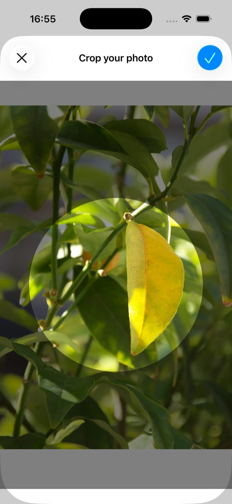
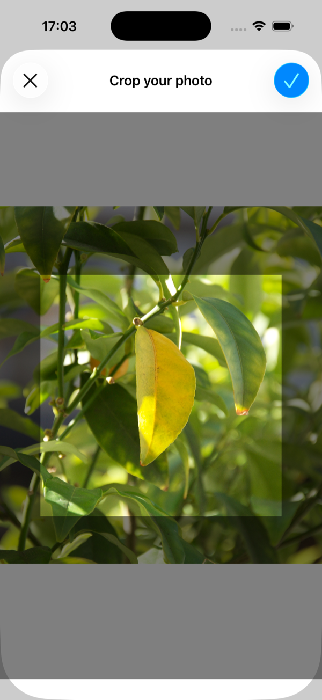

# CropImage

     

A lightweight SwiftUI view for interactively cropping images on iOS.


## 📝 Overview

1. A reusable SwiftUI component for cropping images, distributed via Swift Package Manager.
2. Lets users pan and pinch-to-zoom an image inside a fixed crop region, then returns the cropped result.
3. Supports circle and square crop shapes.
4. Built with pure SwiftUI and no third-party dependencies.
5. Follows MVVM architecture for clean separation of concerns.


## ✨ Features

1. **Pan & zoom** — drag and pinch to position the image within the crop region.
2. **Crop shapes** — choose between a circle or a square mask.
3. **Edge clamping** — the image snaps back so the crop region is always filled.
4. **Fixed output size** — optionally get the crop at an exact pixel size with `outputSide`.
5. **Ready-made screen** — `CropImageView` with your own title and an `onCrop` callback.
6. **Building blocks** — build your own crop screen from `CropArea` and `CropAreaViewModel`, with an optional thirds grid.


## 🛠️ Technologies & Frameworks

- iOS 26
- Swift 6
- SwiftUI
- Swift Package Manager - distribution


## 🔧 Development Tools

- Xcode 27.2
- Icons: [SF Symbols](https://developer.apple.com/sf-symbols/)
- Version control: GitHub / Git
- AI tools: [Claude Code](https://claude.com/claude-code)


## 📦 Installation

### Swift Package Manager

Add the package in Xcode via **File → Add Package Dependencies…** and enter the repository URL:

```
https://github.com/quien697/CropImage.git
```

Or add it to your `Package.swift`:

```swift
dependencies: [
    .package(url: "https://github.com/quien697/CropImage.git", from: "1.1.0")
]
```


## 💻 Usage

There are two ways to use CropImage:

| | 1. `CropImageView` | 2. `CropArea` + `CropAreaViewModel` |
|---|---|---|
| What it is | A ready-made crop screen | A crop component inside a screen you build |
| What it includes | Navigation bar, title, close and Confirm buttons | The image with pan and zoom, the dimmed surround and the crop shape, plus an optional thirds grid |
| How you get the image | The `onCrop` closure | `crop(outputSide:)` on the view model, called from your own button |
| Use it when | A sheet with a title and Confirm is enough | You need your own navigation (such as a push), buttons, hints, a Reset button or the grid |

Both have the same crop region, pan and zoom, and give the same output. The cropped image is always square: a `.circle` crop isn't masked, so clip it to a circle where you display it.

Available crop shapes:

```swift
public enum CropShape: Sendable {
    case circle
    case square
}
```

### 1. Ready-made screen: `CropImageView`

Present `CropImageView` (for example, in a sheet) with an image and a crop shape. The `onCrop` closure delivers the cropped `UIImage` when the user confirms, or `nil` if rendering fails; Confirm stays disabled until there is an image.

```swift
import CropImage
import SwiftUI

struct ContentView: View {
    @State private var sourceImage: UIImage?
    @State private var croppedImage: UIImage?
    @State private var isCropping = false

    var body: some View {
        // ...
        .sheet(isPresented: $isCropping) {
            if let sourceImage {
                CropImageView(image: sourceImage, cropShape: .circle) { result in
                    croppedImage = result
                }
            }
        }
    }
}
```

By default the cropped image is the crop region's size in points, rendered at scale 1. Pass `outputSide` to get a fixed size in pixels instead (up to 8192), for example a 1024 × 1024 square:

```swift
CropImageView(image: sourceImage, cropShape: .square, outputSide: 1024) { result in
    croppedImage = result
}
```

The title defaults to "Crop your photo". Pass your own `title`; like any SwiftUI title, it's looked up in your app's strings:

```swift
CropImageView(image: sourceImage, cropShape: .square, title: "Frame your photo") { result in
    croppedImage = result
}
```

### 2. Your own screen: `CropArea` and `CropAreaViewModel`

Put a `CropArea` in a screen you build. It fills the space you give it and has no navigation bar of its own, so you can push the screen onto your navigation stack, or present it in a sheet inside your own `NavigationStack`. Keep a `CropAreaViewModel` in that screen's `@State`, one per area, pass it to the `CropArea`, and call it from your buttons: `crop(outputSide:)` returns the cropped image (or `nil` if there is no image yet or rendering fails), and `reset()` returns to the initial framing. Without `outputSide`, the image is the crop region's size in points, as with `CropImageView`.

The framing belongs to the view model, so a view model kept in the screen's state starts each visit at the initial framing and releases the photo with the screen. Set `showsGrid` to draw lines that divide the crop region into thirds; they are never part of the cropped image.

```swift
import CropImage
import SwiftUI

struct FramePhotoView: View {
    @Environment(\.dismiss) private var dismiss
    @State private var viewModel = CropAreaViewModel()
    let photo: UIImage
    let onFramed: (UIImage) -> Void

    var body: some View {
        CropArea(image: photo, cropShape: .square, viewModel: viewModel, showsGrid: true)
            .navigationTitle("Frame your photo")
            .toolbar {
                ToolbarItem(placement: .bottomBar) {
                    Button("Reset") { viewModel.reset() }
                }
                ToolbarItem(placement: .confirmationAction) {
                    Button(role: .confirm) {
                        if let framed = viewModel.crop(outputSide: 840) {
                            onFramed(framed)
                        }
                        dismiss()
                    }
                }
            }
    }
}
```

Push it from your own navigation stack:

```swift
NavigationLink("Frame your photo") {
    FramePhotoView(photo: photo) { framed in
        framedPhoto = framed
    }
}
```


## 📂 Folder Structure

```text
CropImage/
├─ Sources/
│  └─ CropImage/
│     ├─ Models/         # CropShape
│     ├─ ViewModels/     # CropAreaViewModel (framing, gestures, rendering)
│     ├─ Views/          # CropImageView, CropArea, CropMaskView, CropGridView, CropShapeView
│     ├─ Utilities/      # CropGeometry (pure geometry helpers)
│     └─ Previews/       # Preview support
├─ Tests/
│  └─ CropImageTests/    # Swift Testing: crop output, gestures, geometry, public API
├─ openspec/             # Development specs and change history (OpenSpec)
└─ Screenshots/
```


## 📸 Screenshots

<p align="left">
   
   
</p>


## 🚀 Getting Started

Add the package to your project (see [Installation](#-installation)), then present `CropImageView` or build your own screen around `CropArea` (see [Usage](#-usage)).

To see it working, open the package in Xcode and look at the previews: `CropImageView.swift` shows the ready-made screen with each crop shape, and `CropArea.swift` shows a screen an app might build around `CropArea`.


## 👨‍💻 Author

**Tsung-Hsun Liu**  
📧 [quien697@gmail.com](mailto:quien697@gmail.com)  
🌐 [tsunghsun.me](https://www.tsunghsun.me)


## 📄 License

MIT License © 2026 Tsung-Hsun Liu
